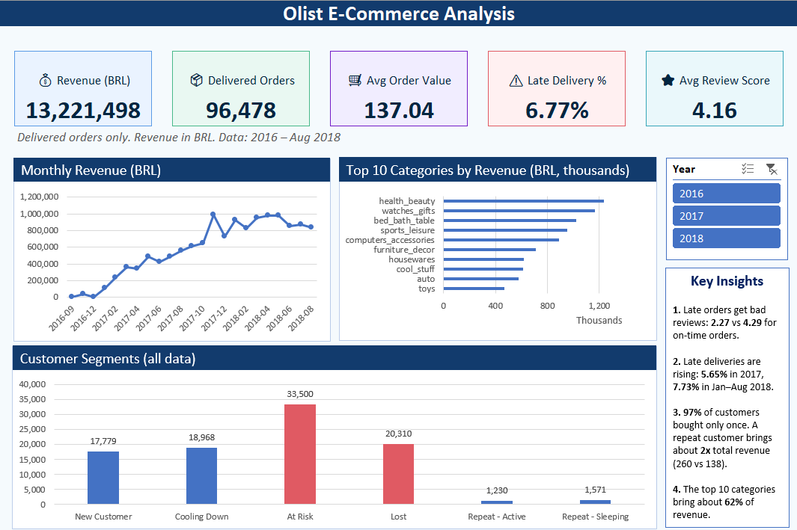
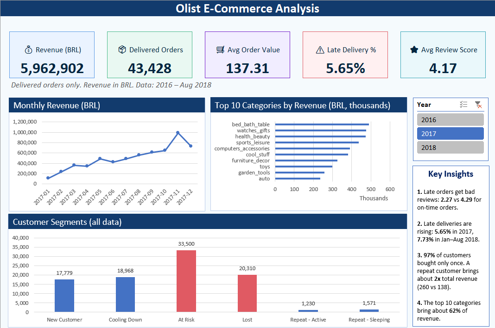

# Olist E-Commerce Analysis in Excel

**Finding out where an online shop makes money, where it loses customers, and why customers leave bad reviews, using only Excel.**



---

## Why I made this project

Every online shop collects a lot of data: who bought what, when, how much they paid, and how they felt about it. But a long list of numbers does not help a shop owner. The owner needs clear answers:

- Where is our money coming from?
- Are customers happy with us?
- Do customers come back after their first order?
- What should we fix first?

I made this project to show that I can turn a big, messy pile of data into simple answers that a shop owner can use. I also wanted to prove my advanced Excel skills with real work, not only a line on my resume.

## The data

I used a real public dataset from an online marketplace in Brazil called **Olist**. It has about **99,000 orders** from 2016 to August 2018, split across several tables: orders, customers, products, sellers, payments and reviews.

Think of a Bangladeshi online shop like Daraz. The idea is the same: orders, delivery, payments and reviews. Money amounts are in Brazilian Real (BRL).

## What I found

**1. Late delivery makes customers unhappy.**
Customers rate their order from 1 to 5. On-time orders get an average of **4.29**. Late orders get only **2.27**. About 7 out of every 100 delivered orders were late (6.77%).

**2. Late deliveries are getting worse.**
5.65% of orders were late in 2017. In the first 8 months of 2018, it was 7.73%.

**3. Most customers never come back.**
Out of every 100 customers, **97 bought only once**. Only 3 bought again. But a returning customer brings about **twice as much money** over time (about 260 BRL vs 138 BRL).

**4. A few product groups bring most of the money.**
The top 10 product categories bring about **62%** of all sales. The biggest are health and beauty, watches and gifts, and bed, bath and table items.

**5. Most customers are drifting away.**
I grouped customers by how long ago they last bought:

| Group | Meaning | Customers |
|---|---|---|
| New Customer | Bought once, in the last 90 days | 17,779 |
| Cooling Down | Bought once, 91 to 180 days ago | 18,968 |
| At Risk | Bought once, 181 to 365 days ago | 33,500 |
| Lost | Bought once, over 365 days ago | 20,310 |
| Repeat - Active | Bought 2+ times, recently | 1,230 |
| Repeat - Sleeping | Bought 2+ times, not recently | 1,571 |

**Total sales (delivered orders only): 13,221,498 BRL** from 96,478 orders. The average order is worth 137 BRL.

## What I would suggest to the shop owner

These ideas come from the numbers above. They are my suggestions, not proven facts.

1. **Fix delivery first.** Late orders get the worst reviews, and the late rate is growing.
2. **Bring new customers back.** The 17,779 new customers are the best chance. A small offer for a second order could help, because a returning customer is worth about twice as much.

## How I built it 

I did everything inside Excel. Here are the steps, like a cooking recipe:

| Step | What I did | Excel tool |
|---|---|---|
| 1. Collect | Downloaded the free dataset from Kaggle (8 tables used) | - |
| 2. Clean | Fixed data types, joined tables together, translated product names to English, and added labels like "Delivered" and "Late" | Power Query |
| 3. Connect | Linked the tables together like a map, so one question can use many tables | Power Pivot (Data Model) |
| 4. Calculate | Wrote formulas for sales, orders, average order value, late delivery rate and review score | DAX |
| 5. Group customers | Built a customer table showing how recently, how often and how much each person bought | Power Query |
| 6. Show | Built a dashboard with number cards, charts and a year button | PivotCharts, Slicer, CUBEVALUE |

**How to use the dashboard:** click a year (2016, 2017, 2018) in the Year box. The number cards and the first two charts change. The customer chart always shows all years.



## Things to know

- Sales count **delivered orders only**. Canceled and unfinished orders are kept in the data but not counted as sales.
- The data ends in **August 2018**, and 2016 has very few orders. So I only compare months that have data on both sides.
- The customer groups use cut-off days (90, 180, 365) that **I chose myself**. They are simple business rules and can be changed.
- 8 delivered orders have no delivery date. They stay in the sales total, but they are left out of the late vs on-time comparison.
- 623 products have no English category name. They are shown as "Unknown".
- Late orders and low reviews go together, but I cannot prove that lateness is the only reason for bad reviews.

## What I learned

- **One order can have many items.** If I count rows, I count some orders twice. So I count each order number only once.
- **One person can have many customer IDs.** The dataset gives a new ID for every order, so I used the "unique" ID to find the real person. Without this, every customer would look like a one-time buyer.
- **Excel's preview only shows a small sample.** I checked data quality with a PivotTable, which reads every row.
- **Always check before comparing.** My first growth number compared 8 months against a full year. I fixed it so only equal periods are compared.
- **Test after every change.** When I renamed tables, the links between them broke. I rebuilt them and checked my numbers against known totals.

## Skills shown in this project

Power Query (data cleaning) | Power Pivot and Data Model | DAX formulas | PivotTables and PivotCharts | Slicers | CUBEVALUE | Customer segmentation (RFM idea) | Data quality checks | Dashboard design | Business storytelling

<details>
<summary><b>For technical readers: method details</b></summary>

- Orders are counted with a distinct count of `order_id`.
- Customers are counted with `customer_unique_id`, not `customer_id`.
- Late = delivered after the estimated delivery date (`Delay Days > 0`).
- Recency is measured from the last order date in the data (plus 1 day), not from today.
- The usual 1-5 RFM scoring was not used, because 97% of customers have only one order.
- 7 relationships in the Data Model, plus a Date Table marked as the date table.
- The geolocation table (about 1 million rows) was not used.
- Data model size was reduced by removing unused columns.

Example measures:

```
Revenue = CALCULATE(SUM('Order Items'[price]), Orders[Order Group] = "Delivered")

Late Delivery % =
DIVIDE(
    CALCULATE(
        DISTINCTCOUNT(Orders[order_id]),
        Orders[Order Group] = "Delivered",
        Orders[Delay Days] > 0
    ),
    [Delivered Orders]
)
```

Other measures: Delivered Orders, Freight Cost, Avg Order Value, Revenue LY, Revenue Growth %, Avg Review Score, Customers, Segment Revenue.

</details>

## Data source

[Olist Brazilian E-Commerce Public Dataset](https://www.kaggle.com/datasets/olistbr/brazilian-ecommerce) on Kaggle. The raw data files are not included here. Please check the license on the Kaggle page.

## How to open the Excel file

1. Go to the **Releases** section on the right side of this page.
2. Download `olist_analysis.xlsx` (about 38 MB).
3. Open it in desktop Excel (2019 or newer). The dashboard works right away.

The data connections point to files on my computer. To refresh the data, download the dataset from Kaggle and change the file paths in Power Query.

## About me

**Nusrat Mili** | MSc student in Data Science, looking for Data Analyst and Business Intelligence roles.

[LinkedIn](https://www.linkedin.com/in/nusrat-mili-3a21a9162/) | [GitHub](https://github.com/NusraatMili)
